# X Electronics Warehouse

A small warehouse-management application built with Frappe Framework. It is intentionally smaller than ERPNext and does not require ERPNext.

## Problem and solution

X Electronics needs to know how much stock is in each warehouse and which transactions produced that balance.

- Stock Entry is the document a warehouse user creates.
- Stock Ledger Entry is created automatically when a Stock Entry is submitted and is never edited or deleted.
- Stock Balance shows the remaining quantity and value.
- Stock Ledger shows every movement in time order.
- Receipts can be linked to Suppliers, and Consume entries can be linked to Customers.
- Supplier and Customer masters provide purchasing and sales traceability.
- Purchase Receipt adds supplier stock through a linked Stock Entry; Sales Issue consumes stock for a customer through the same linked posting path.
- Sales Issues capture selling rate, expected revenue, valuation cost, expected gross profit, and expected margin.
- Stock Checkout records who received stock, who issued it, the quantity, cost value, returns, and the outstanding custody balance.
- Stock Checkout Return records partial or full returns and posts the returned quantity back into the warehouse.
- Stock Count records the system quantity, physical count, variance, variance value, counter, and the adjustment Stock Entry used to reconcile it.
- Every Stock Count also stores a clear Has Discrepancy flag plus total discrepancy quantity and value; the Stock Discrepancy report is intentionally empty for clean counts.
- Stock adjustments require a reason and direction, so increases and decreases are visible in the audit trail instead of silently changing stock.
- Items can be configured for no tracking, batch tracking, or serial tracking. Tracked movements carry their batch or serial identifier through receipts, consumption, transfers, reversals, and the Stock Ledger report.
- Transfers require approval by a Warehouse Manager before submission. The app creates Warehouse User and Warehouse Manager roles during installation or migration.
- A daily scheduler creates one in-app Low Stock notification per Warehouse Manager when reorder thresholds are breached.
- Warehouse Dashboard is available in Desk at `/app/warehouse-dashboard` with stock totals and low-stock items.
- `/` is the public XWarehouse landing page; authenticated warehouse roles land in the dashboard.
- `/app/warehouse-call` is the authenticated Vue call-centre screen for the administrator's daily summary.
- At 17:00 in the site timezone, the scheduler creates one `Voice Call Session` for `Administrator`. The session stores a factual snapshot of stock, sales, low-stock lines, and recorded stock-count variances; it does not infer fraud.

For a local test after migrating the site:

```bash
cd /Users/iampaulking/projects/duchess/frappe-projects/mybenches
bench --site xwarehouse migrate
bench --site xwarehouse execute electronics.x_electronics_warehouse.api.create_daily_admin_call_session
```

Sign in as `Administrator`, open `/app/warehouse-call`, and use “Talk to voice agent” to start the Pipecat browser WebRTC call inside the warehouse page. Start the agent first from `services/voice-agent` with `uv run python bot.py --transport webrtc`; it listens on the local runner at `http://localhost:7860`. Allow microphone access when prompted. The “Preview summary” action remains available for testing the Frappe session without starting a live call.

For local microphone access, use `http://localhost:8001` for the call-centre page (or serve Frappe over HTTPS). Browsers do not expose microphones to custom insecure HTTP hostnames such as `http://xwarehouse:8001`.

~~~mermaid
flowchart LR
    A[Define Item] --> B[Define Warehouse]
    B --> C[Create Stock Entry]
    C --> D{Purpose}
    D -->|Receipt| E[Add stock]
    D -->|Consume| F[Remove stock]
D -->|Transfer| G[Move source to target]
D -->|Adjustment| A2[Reconcile count variance]
    E --> H[Submit]
    F --> H
G --> H
A2 --> H
    H --> I[Create Stock Ledger Entry]
    I --> J[Stock Balance]
    I --> K[Stock Ledger]
~~~

Editable diagrams:

- [Stock flow explanation - Excalidraw](docs/stock_flow.excalidraw)
- [Application architecture - Draw.io](docs/architecture.drawio)

Open the first file in [Excalidraw](https://excalidraw.com/) and the second in [diagrams.net](https://app.diagrams.net/).

## DocTypes and tables

Every Frappe DocType becomes a MariaDB table, normally named tab plus the DocType name.

### Item (tabItem)

Defines a product. It does not store the current quantity.

| Label | Fieldname | Type | Purpose |
|---|---|---|---|
| Item Code | item_code | Data, mandatory, unique | Code such as HDMI-CABLE; also the document name |
| Item Name | item_name | Data, mandatory | Readable name such as HDMI Cable |
| Unit | unit | Data | Unit of measure; NOS means individual pieces |
| Valuation Method | valuation_method | Select | Currently Moving Average |

### Warehouse (tabWarehouse)

Defines a stock location and is a tree DocType.

| Label | Fieldname | Type | Purpose |
|---|---|---|---|
| Warehouse Name | warehouse_name | Data, mandatory, unique | Readable location name |
| Parent Warehouse | parent_warehouse | Link to Warehouse | Parent in the tree |
| Is Group | is_group | Check | Whether this node can contain children |
| Left / Right | lft, rgt | Int | Frappe tree bookkeeping fields |

The tree parent field is parent_warehouse; the naming rule is field:warehouse_name.

### Stock Entry Item (tabStock Entry Item)

This is a child table inside Stock Entry.

| Label | Fieldname | Type | Purpose |
|---|---|---|---|
| Item | item | Link to Item | Product moved |
| Quantity | qty | Float | Number of units |
| Rate | rate | Currency | Incoming price per unit |
| Selling Rate | selling_rate | Currency | Expected selling price for Sales Issues |
| Adjustment Direction | adjustment_direction | Select | Increase or Decrease for reconciliation |

### Stock Entry (tabStock Entry)

This is the user-facing, submittable transaction.

| Label | Fieldname | Type | Purpose |
|---|---|---|---|
| Posting Date | posting_date | Date | Transaction date |
| Posting Time | posting_time | Time | Transaction time |
| Purpose | purpose | Select | Receipt, Consume, or Transfer |
| Source Warehouse | source_warehouse | Link to Warehouse | Where stock leaves |
| Target Warehouse | target_warehouse | Link to Warehouse | Where stock enters |
| Items | items | Table: Stock Entry Item | Item rows |

| Purpose | Source | Target | Meaning |
|---|---|---|---|
| Receipt | Not required | Required | Add stock after buying or receiving goods |
| Opening Stock | Not required | Required | Establish an initial balance when setting up the system |
| Consume | Required | Not required | Remove stock for a sale, internal use, or damage |
| Transfer | Required | Required | Move stock between two warehouses |
| Adjustment | Same warehouse | Same warehouse | Reconcile a physical stock count with a reason |

### Stock Ledger Entry (tabStock Ledger Entry)

This is a permanent, non-submittable history row. Users should not create it manually.

| Label | Fieldname | Type | Purpose |
|---|---|---|---|
| Posting Date | posting_date | Date | Movement date |
| Posting Time | posting_time | Time | Movement time |
| Item | item | Link to Item | Product |
| Warehouse | warehouse | Link to Warehouse | Affected location |
| Quantity Change | actual_qty | Float | Positive for addition, negative for removal |
| Incoming Rate | incoming_rate | Currency | Rate supplied for incoming stock |
| Valuation Rate | valuation_rate | Currency | Current moving-average rate |
| Quantity After Transaction | qty_after_transaction | Float | Balance after this movement |
| Stock Value | stock_value | Currency | Balance quantity multiplied by rate |
| Stock Entry | stock_entry | Link to Stock Entry | Source transaction |

## How users operate the system

### Receipt: buying or receiving stock

1. Open Stock Entry.
2. Set Purpose to Receipt.
3. Set Target Warehouse.
4. Add the Item, Quantity, and Rate.
5. Save and submit.

Example: receiving 10 HDMI cables at KES 1,000 creates 10 units worth KES 10,000. Submission automatically creates the ledger row.

### Opening stock: initial balances and imports

Use the Opening Stock purpose when loading balances from an existing spreadsheet or when setting up the first inventory balance. It uses the same ledger, valuation, negative-stock protection, reports, and cancellation reversal behavior as other stock movements. Multiple rows can be added for different items and warehouses, and the Stock Entry can be loaded through Frappe's standard Data Import tool.

### Consume: selling or using stock

This assignment has no separate Sales Invoice DocType, so a sale is represented by a Consume Stock Entry.

1. Set Purpose to Consume.
2. Set Source Warehouse.
3. Add the Item and Quantity.
4. Save and submit.

The system rejects a Consume when the requested quantity is greater than the available balance. Consuming 3 after receiving 10 leaves 7.

### Cancelling a Stock Entry

A submitted Stock Entry can be cancelled when no later stock movement exists for the same item and warehouse. Cancellation does not delete the original ledger rows; it creates compensating reversal rows linked to the original ledger entries. If later movements exist, cancel the later transactions first.

### Transfer: moving stock

1. Set Purpose to Transfer.
2. Set both Source and Target Warehouses.
3. Add the Item and Quantity.
4. Save and submit.

A transfer creates two ledger rows: a negative row in the source and a positive row in the target. It changes location, not the total business quantity.

### Checkout and returns: custody control

Use Stock Checkout when stock leaves the warehouse for an employee, team, department, or job. The submitted document creates a linked Consume Stock Entry and records the receiving user, issuing user, warehouse, quantity, cost rate, and outstanding quantity. Use Stock Checkout Return to record partial or full returns; the linked Receipt Stock Entry restores the stock and updates custody status.

The Stock Accountability report shows who currently holds stock, who issued it, quantities returned, quantities still outstanding, and the outstanding cost value.

### Stock counts and discrepancies

Create a Stock Count for a warehouse and enter the physical quantity found. On submission, the system captures the system quantity and valuation rate, calculates the quantity and value variance, and creates a linked Adjustment Stock Entry for any difference. The Stock Discrepancy report shows the counter, expected quantity, counted quantity, shortage/overage, value impact, and adjustment reference.

## Moving Average valuation

For incoming stock:

~~~text
new quantity = old quantity + incoming quantity
new value = old value + (incoming quantity x incoming rate)
new rate = new value / new quantity
~~~

Example:

~~~text
10 x KES 100 = KES 1,000
10 x KES 200 = KES 2,000
20 units worth KES 3,000
Moving average rate = KES 3,000 / 20 = KES 150
~~~

When stock is consumed, value is reduced using the current rate. During a transfer, the source rate is carried to the target.

## Reports

Stock Balance answers “how much remains?” It displays Item Code, Item Name, Warehouse, Quantity In Stock, Moving Average Rate, and Stock Value up to the selected date.

Low Stock lists item/warehouse balances at or below the Item's Reorder Level. A reorder level of zero disables the alert; Reorder Quantity records the suggested replenishment amount.

The app also exposes read-only methods for integrations:

- `electronics.x_electronics_warehouse.api.get_stock_balance(item, warehouse)`
- `electronics.x_electronics_warehouse.api.get_low_stock(item, warehouse)`
- `electronics.x_electronics_warehouse.api.get_dashboard_summary()`

Stock Ledger answers “what happened?” It displays date, time, item, warehouse, Quantity Change, rates, Balance After Transaction, Stock Value, and the source Stock Entry.

Sales Profit answers “what did we expect to earn?” It shows expected revenue, valuation cost, expected gross profit, and margin for each submitted Sales Issue. These are expected gross figures based on the selling rates entered at issue time; they are not a replacement for a full accounting ledger.

## Screenshots

### Item

The product master. The list shows every item with its code, and the form shows the unit, valuation method, reorder level and quantity, and tracking method. The item does not store a quantity; stock comes from the ledger.

| List | Form |
|---|---|
| 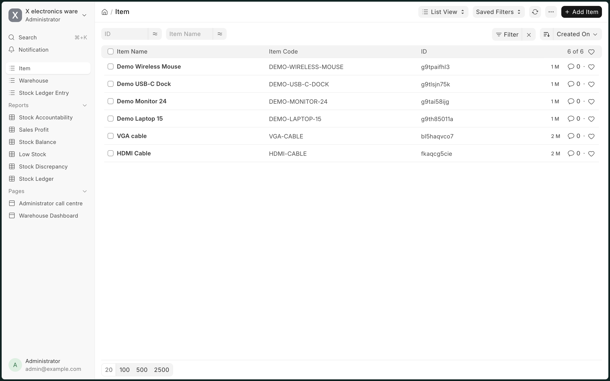 | 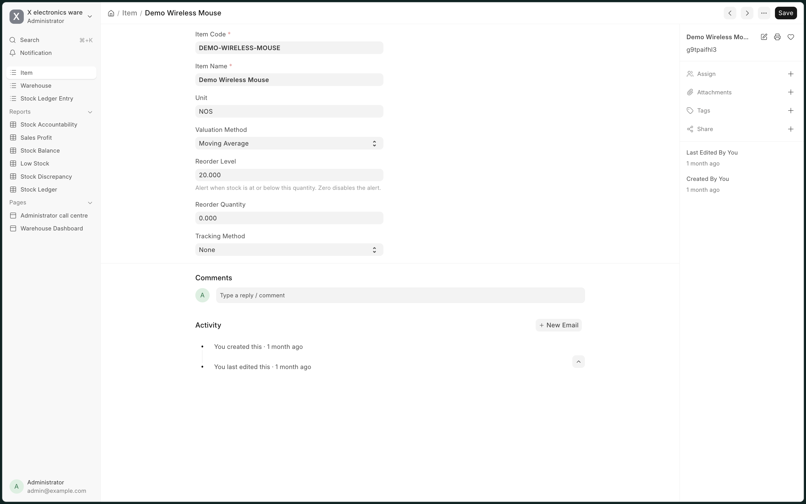 |

### Warehouse tree

Warehouses are a tree DocType, with Parent Warehouse and Is Group controlling the hierarchy.

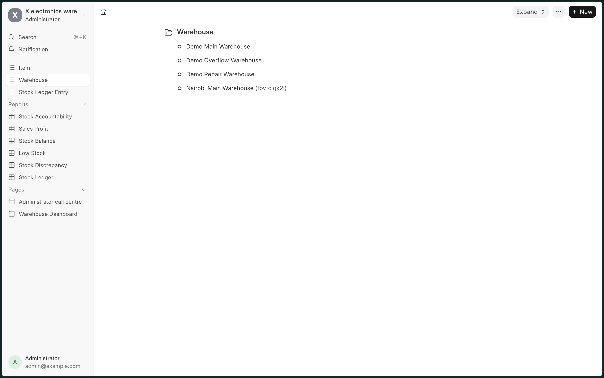

### Stock Entry: Receipt, Consume, Transfer and Adjustment

The submittable transaction. Every entry carries an Approval Status, and each row records the item, quantity and rate. Submitting an entry writes its Stock Ledger Entry rows.

**Receipt** adds stock to the target warehouse at the given rate, linked to the Supplier it came from.

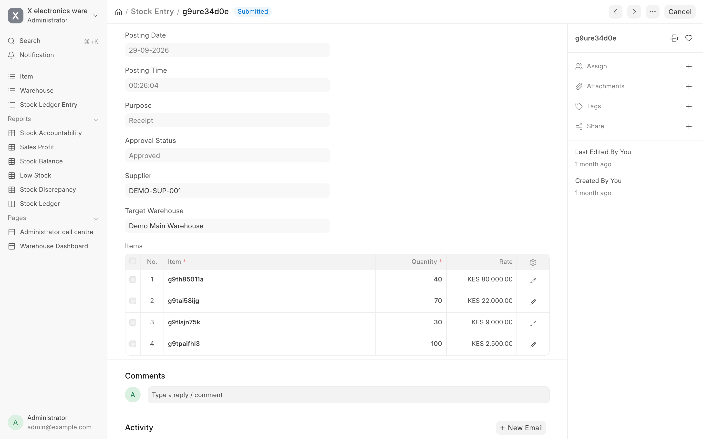

**Consume** removes stock from the source warehouse at the current moving-average rate, linked to the Customer it went to.

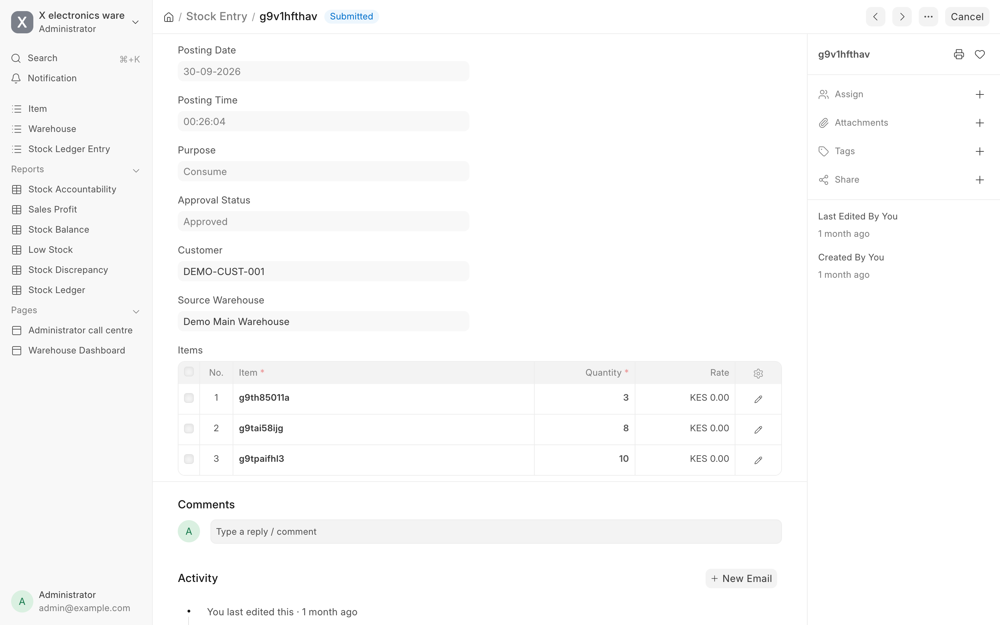

**Transfer** moves stock from source to target and carries the source rate across. It needs Warehouse Manager approval before it can be submitted.

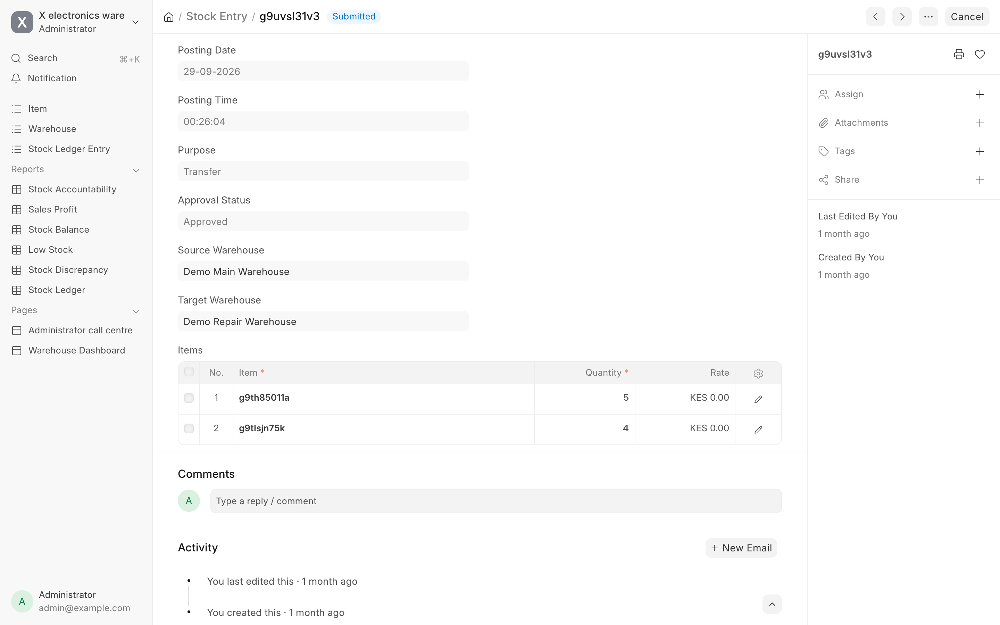

**Adjustment** reconciles a physical count. It is created from a Stock Count, uses the same warehouse as source and target, and records the reason for the change.

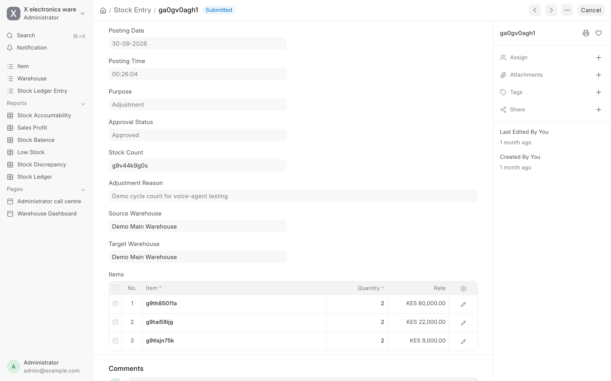

### Stock Ledger Entry

The permanent, system-created ledger rows. Each stock movement appends a row here when a Stock Entry is submitted. The form shows one row in full: the quantity change, rates, the balance after the transaction, the stock value and the Stock Entry that produced it.

| List | Form |
|---|---|
| 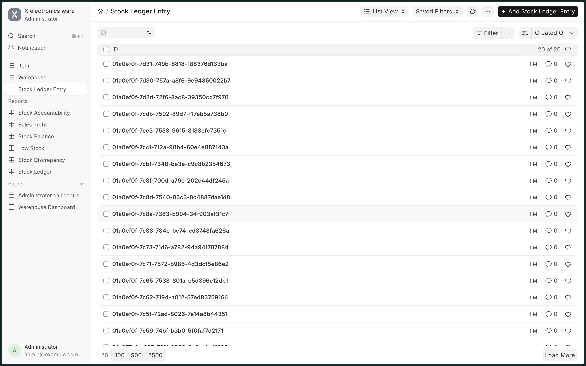 | 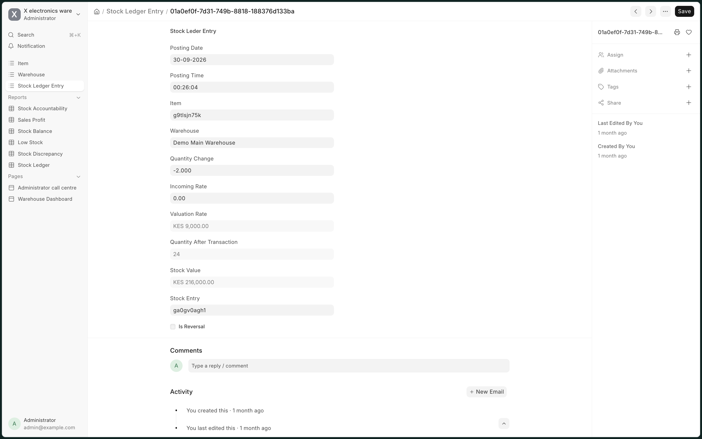 |

### Stock Balance report

Quantity in stock, moving average rate and stock value per item and warehouse, filterable by date, item and warehouse.

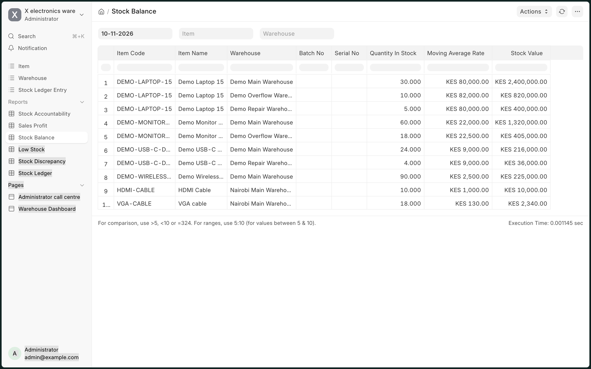

### Stock Ledger report

Every stock movement in time order: date, time, item, warehouse, quantity change (positive for additions, negative for removals), incoming rate, valuation rate and the running balance.

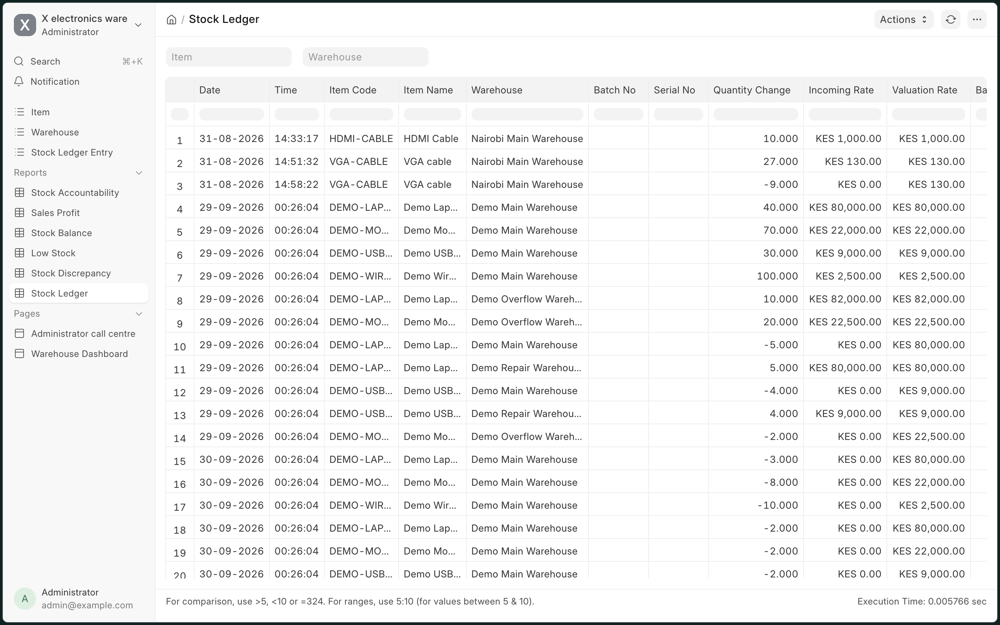

### Low Stock report

Item and warehouse balances at or below the item's reorder level, with the reorder quantity and valuation rate.

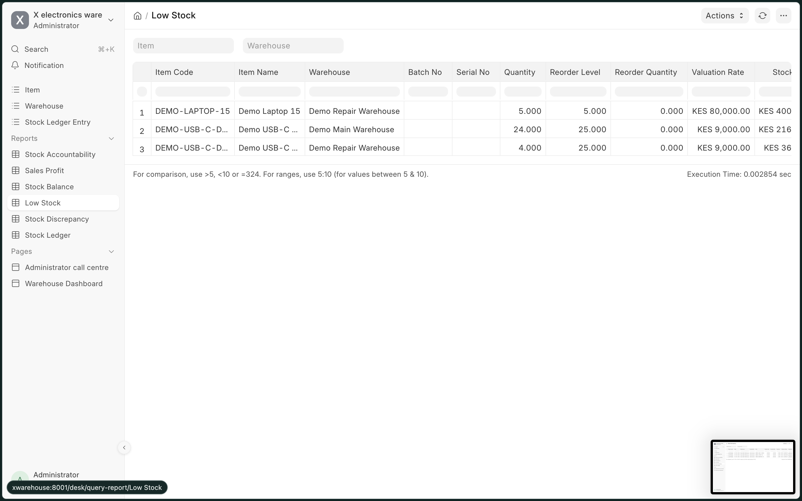

### Stock Discrepancy report

Stock count variances: system quantity against counted quantity, the variance and its value, who counted, and the linked adjustment entry.

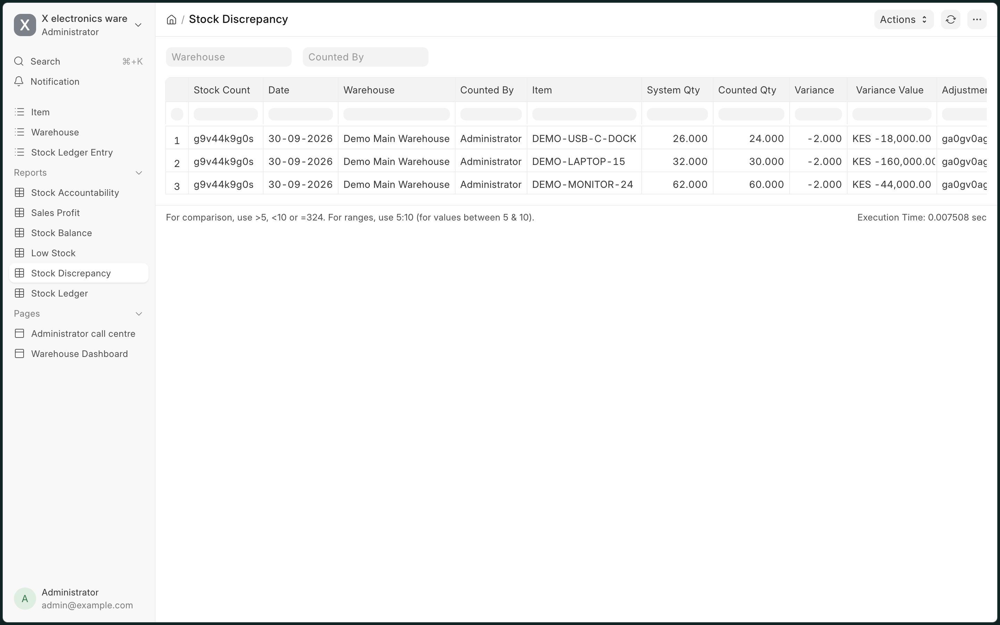

### Sales Profit report

Expected revenue, valuation cost, expected profit and margin for each Sales Issue.

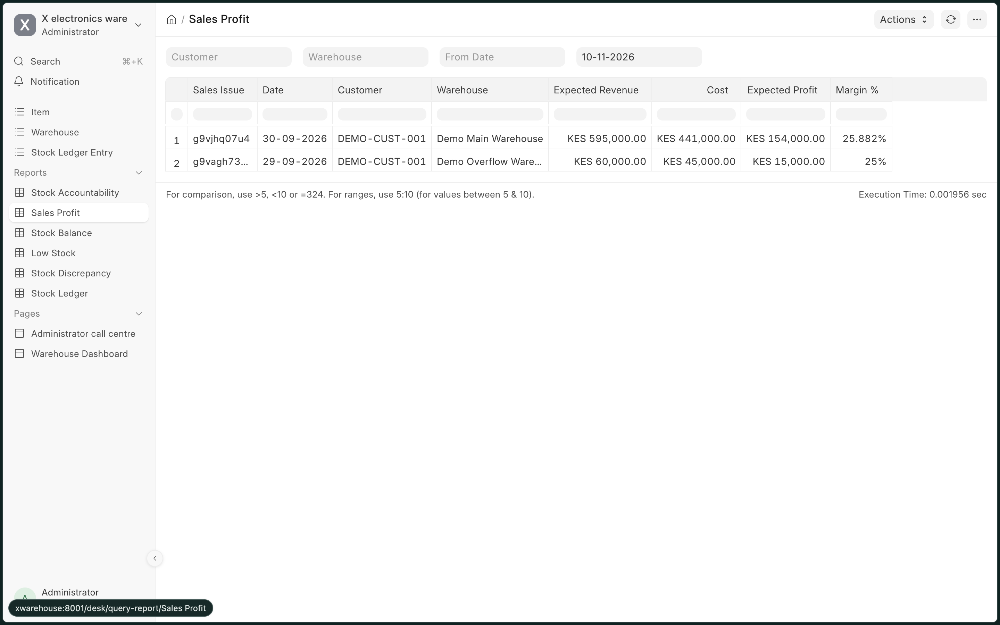

## Architecture

~~~mermaid
flowchart TB
    U[Warehouse User] --> D[Frappe Desk]
    D --> SE[Stock Entry]
    SE --> C[stock_entry.py: validate and on_submit]
    C --> S[stock.py: add_stock and get_balance]
    S --> L[(Stock Ledger Entry)]
    SE --> I[(Item)]
    SE --> W[(Warehouse)]
    L --> R1[Stock Balance report]
    L --> R2[Stock Ledger report]
    I --> DB[(MariaDB)]
    W --> DB
    L --> DB
~~~

The controller validates the transaction and calls the small functions in stock.py. Cancellation uses the same stock functions to append compensating ledger rows. The ledger is the source of truth; reports read it and join Item and Warehouse to show readable names.

## Installation

ERPNext is not needed.

~~~bash
cd /path/to/your/bench
bench get-app https://github.com/paulwritescode/xwarehouse.git
bench --site xwarehouse install-app electronics
bench --site xwarehouse migrate
~~~

For local development:

~~~bash
cd /path/to/your/bench
bench start
~~~

## Testing

Business tests are in electronics/x_electronics_warehouse/tests/test_stock.py.

~~~bash
bench --site xwarehouse set-config allow_tests true
bench --site xwarehouse run-tests --app electronics
~~~

The tests cover Receipt, automatic ledger creation, Consume, Transfer, Moving Average valuation, and negative-stock protection.

## GitHub checklist

The app source is hosted at https://github.com/paulwritescode/xwarehouse.

To clone it into an existing bench:

~~~bash
cd /path/to/your/bench
gh repo clone paulwritescode/xwarehouse apps/electronics
~~~

If the app already exists locally, update it with:

~~~bash
cd /path/to/your/bench/apps/electronics
git pull origin main
~~~

Do not commit the bench env/, site data under sites/, database data, passwords, API keys, Redis files, logs, or generated assets.

## License

MIT
